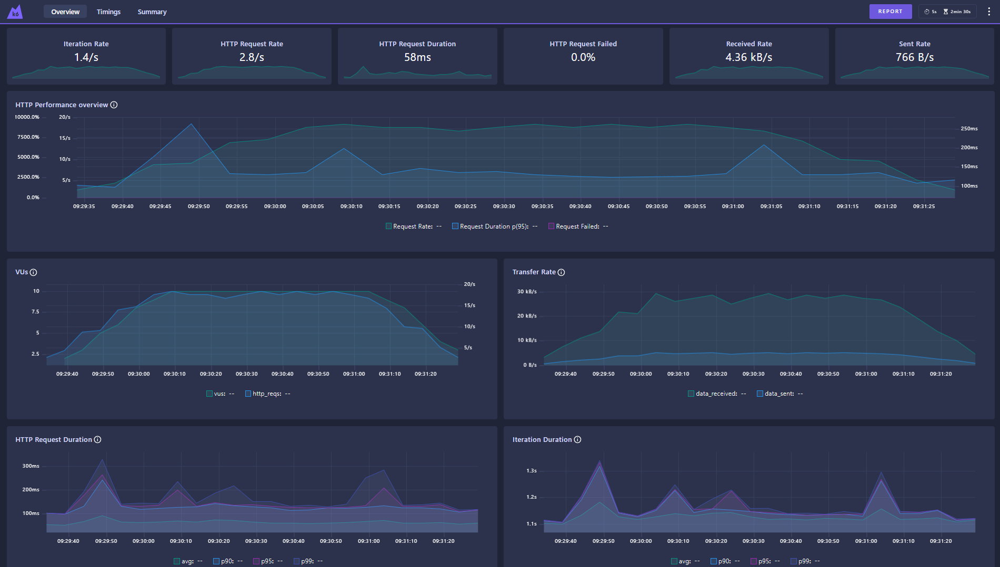
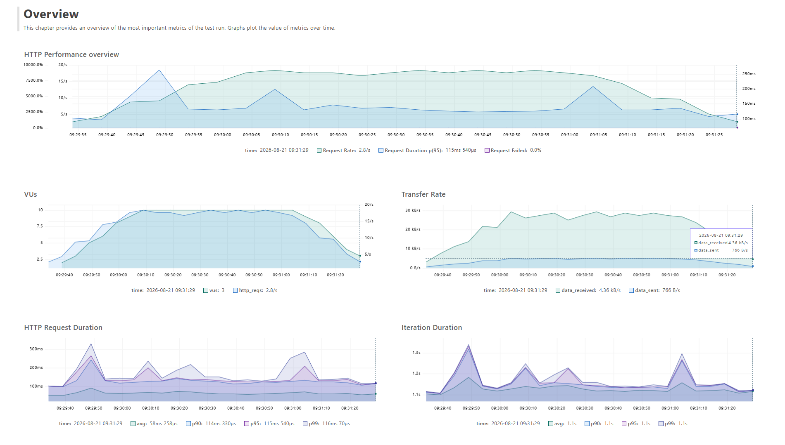
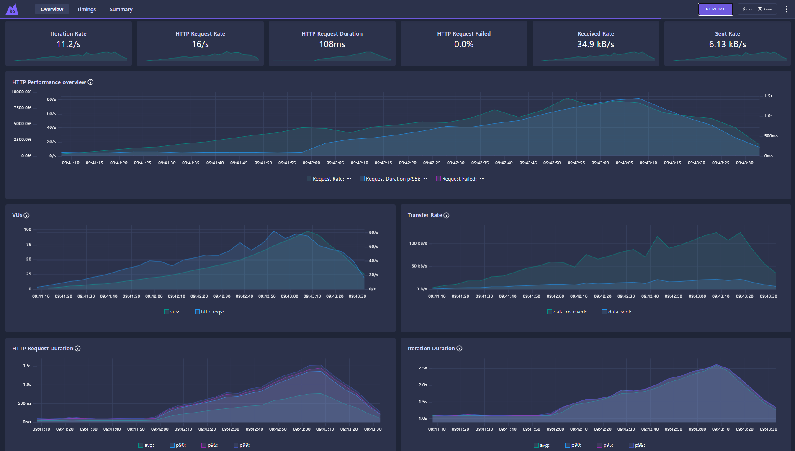
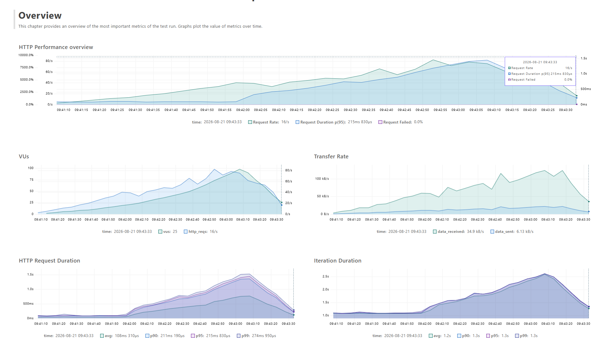

# Atividade K6 - Testes de Performance 🚀

Desafio prático de testes de performance utilizando a ferramenta K6 focado na API REST do **Hub de leitura**.

## 📈 Estratégia de Testes

Foram implementados dois modelos de cenários com variação de carga no K6:

### 1. Teste de Carga (Load Test)
**Arquivo:** `tests/load-test.js`  
**Objetivo:** Avaliar o comportamento do sistema sob uma condição de concorrência normal e prevista para mapear as métricas base da aplicação.  
**Relatório Gerado:** `reports/load-test.html`  
- ramp-up de 1 até 10 users em 30 segundos.
- mantém 10 users durante 1 minuto.
- ramp-down de 10 a 0 users em 30 segundos.


### 2. Teste de Estresse (Stress Test)
**Arquivo:** `tests/stress-test.js`  
**Objetivo:** Forçar os limites da API além do esperado para identificar o ponto de saturação, possíveis gargalos e a capacidade de recuperação do servidor.  
**Relatório Gerado:** `reports/stress-test.html`  
- Nos primeiros 30 segundos, começa um ramp-up em degraus, o primeiro é de 0 até 10 users.
- Nos 30 segundos seguintes, a carga sobe de 10 para 25 users.
- A carga continua subindo de 25 para 50 users.
- A carga sobe de 50 para 100 users em 30 segundos.
- ramp-down. O teste reduz gradualmente os usuários de 100 de volta para 0, encerrando a execução.

---

## 📊 Resultados e Evidências

### 1. Resultados: Teste de Carga (Load Test)

#### 🖥️ Web dashboard Load Test (Terminal K6)


#### 📈 Report Load Test (Relatório HTML)


---

### 2. Resultados: Teste de Estresse (Stress Test)

#### 🖥️ Web dashboard Stress Test (Terminal K6)


#### 📈 Report Stress Test (Relatório HTML)


---

## 🚀 Como Executar os Testes localmente

Utilize os comandos abaixo:

```bash
# Executar o load test (windows)
$env:K6_WEB_DASHBOARD="true"
$env:K6_WEB_DASHBOARD_EXPORT="../reports/load-test.html"
$env:K6_WEB_DASHBOARD_PERIOD="5s"
k6 run load-test.js

# Executar o stress test (windows)
$env:K6_WEB_DASHBOARD="true"
$env:K6_WEB_DASHBOARD_EXPORT="../reports/stress-test.html"
$env:K6_WEB_DASHBOARD_PERIOD="5s"
k6 run stress-test.js
```
